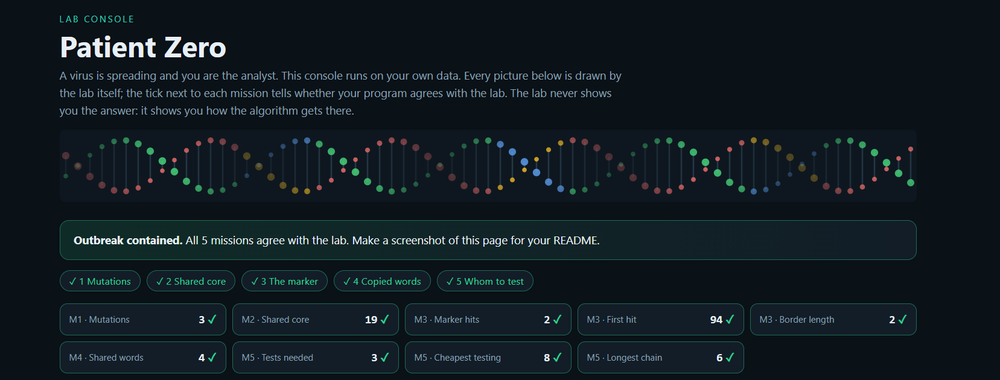

# Assignment 4. Patient Zero

Student ID: 250959
Name: Aizat Kabdyrakmanova
Group: SE-2519

This file is the report. Fill it in as you go. How to start: `START_HERE.md`. The task: `docs/Assignment4.pdf`.

## Program output

The 9 lines your program prints on your data (`java -cp out Main`):

    Mutations: 76
    Shared core: 1083
    Marker hits: 6
    First hit: 4943
    Border length: 4
    Shared words: 522
    Tests needed: 40
    Cheapest testing: 181
    Longest chain: 25

My outbreak report (a screenshot of `output/outbreak.html`):

## Questions

Answer in your own words, two or three sentences each.

Mission 1. What does the cell d[i][j] of your table mean, and how is it computed from other cells?
d[i][j] is the minimum number of edits transforming the first i letters of A into the first j letters of B. Take the minimum of deletion (top + 1), insertion (left + 1) and replacement/match (diagonal + 1/0); the empty-prefix boundaries are i and j.

Mission 2. How is the longest common subsequence different from the longest common substring? My Shared core is bigger than the number of letters that are the same at the same place: why?
A subsequence allows gaps but preserves order; a substring must be contiguous. Insertions or deletions shift matching letters to different indices, so LCS can include letters that a position-by-position comparison misses.

Mission 3. What does the prefix function tell you, and why does the pointer in the text never go back in KMP? What is the Border length of my marker and what does it mean?
pi[i] is the longest proper prefix of p[0..i] that is also its suffix. KMP uses these borders to reuse matched text while moving only the pattern state backwards; the text pointer keeps moving forward. My marker's Border length: TODO after personal run; it describes the equal beginning and ending of that length (ACGAC has border AC, length 2).

Mission 4. Why must you compare the letters after the hashes are equal? What happens to the cost of Rabin-Karp if many windows have the same hash?
Different words can have the same hash, so the letters must be checked before counting. Many colliding windows increase candidate comparisons and can lead to O(x*y*k) verification work, where x and y are the numbers of windows; exact comparisons preserve correctness.

Mission 5. What are the two states of a person in your DP, and how do you get the answer for a person from its children? Why does a greedy "test the person with most links first" not always give the cheapest answer?
The two states are the cheapest subtree costs when its root is tested or not tested. An untested root forces every child to be tested; a tested root lets each child choose its cheaper state. A star whose centre costs 100 and whose three leaves cost 1 each shows why maximum degree can select an expensive solution: the leaves cover every edge for 3.

## AI use
The syllabus requires you to say which AI tools you used and for what. Write the tool (ChatGPT, Copilot, other) and what you asked it: explain an idea, find an error, review code. Write "none" if you did not use any. If you took code or text from a book or a website, give the source here.
ChatGPT was used to read the assignment and starter, explain the algorithms, find an error and review code and check the correctness of README file.

## Timing (Mission 7)

Milliseconds, average of 3 runs, from `java -cp out Bench`.

| test | size | time                        |
|---|---|-----------------------------|
| naive search | 20 000 / 40 000 / 80 000 | 52.5 / 88.3 / 168.7 ms      |
| KMP | 20 000 / 40 000 / 80 000 | 2.7 / 1.3 / 0.4 ms          |
| edit distance | 500 / 1000 / 2000 / 4000 | 7.9 / 15.4 / 30.5 / 79.8 ms |

What do the numbers say about how the time grows? When you double the size, by how much does each time grow? Two or three sentences.
When the text length doubled, naive search took about 1.68× and 1.91× as long. The measured KMP time decreased from 2.7 ms to 0.4 ms, 
possibly because of JVM warm-up and measurement noise in these short runs. When both input strings doubled in length, edit distance took about 1.95×, 
1.98×, and 2.62× as long, compared with the theoretical 4× increase in the number of DP cells.
## Complexity

n is the length of the text (or of a strain), m the length of the pattern, k the length of the window, v the number of people. Fill in every algorithm you wrote.

| algorithm | time | space | assumptions |
|---|---|---|---|
| Edit distance | O(a*b) | O(a*b) | a,b are strain lengths; full table |
| LCS | O(a*b) | O(a*b) | full table |
| Prefix function and KMP | O(m), O(n+m) | O(m), O(m+h) | h returned hit positions |
| Rabin-Karp (shared words) | O(a+b+k+C*k); O(a+b+k+x*y*k) | O(y) | x,y window counts; C candidate comparisons; expected O(a+b) for fixed k and few collisions |
| Tree DP and diameter | O(v) | O(v) | valid connected tree; includes recursion and reconstruction |

## Before you submit

- The four files in `data` and the screenshot `output/outbreak.png` are in the repository.
- `java tools/Check.java` shows all examples right.
- This README is filled in, the program output and the section AI use included.
- The work is pushed to main (at least one commit per mission) and the repository is public.
- The link is attached in Moodle.
